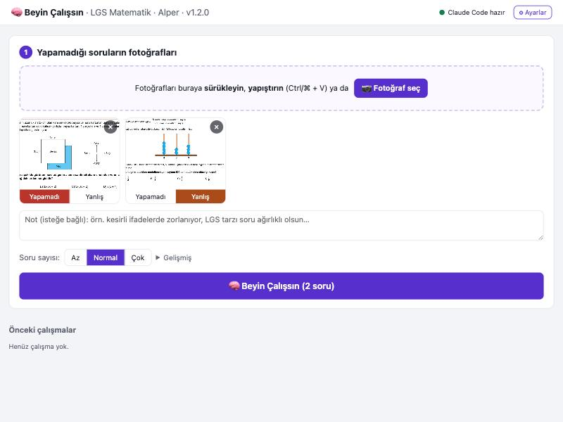
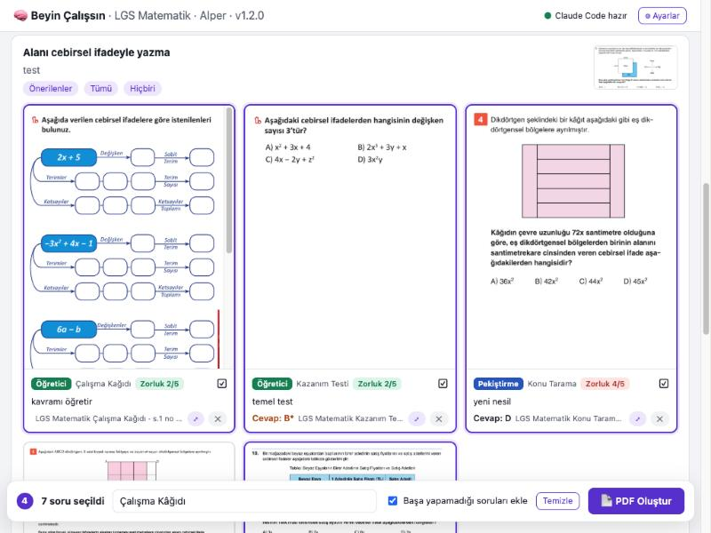

# 🧠 Beyin Çalışsın: Kılavuz

Tek ekran, dört adım: **fotoğrafı yükle → Beyin Çalışsın → soruları seç → PDF al.**

**İçindekiler**
0. [İlk kurulum](#0-ilk-kurulum)
1. [Fotoğrafları yükleyin](#1-fotoğrafları-yükleyin)
2. [Beyin çalışır](#2-beyin-çalışır)
3. [Aday soruları seçin](#3-aday-soruları-seçin)
4. [PDF](#4-pdf)
5. [Önceki çalışmalar ve ayarlar](#5-önceki-çalışmalar-ve-ayarlar)
6. [Sık sorulanlar](#6-sık-sorulanlar)

---

## 0. İlk kurulum

1. **Python 3.12'yi kurun.** Windows: PowerShell'de `winget install -e --id Python.Python.3.12`.
   Mac: `brew install python@3.12` (ya da python.org).
2. **Claude Code'u kurun ve giriş yapın** (bir kez): `claude` yazın, açılınca `/login` ile Claude
   hesabınızla giriş yapın, sonra `/exit`.
3. **Başlatın.** Windows'ta klasördeki **`baslat.bat`**'a çift tıklayın. Mac'te terminalde bu klasörde
   `python3 -m pip install -r requirements.txt` (ilk sefer) ve `python3 -m app.server`.
   Pencere açık kalmalı; o sunucudur. Tarayıcıda `http://localhost:8765` açılır.
4. Sağ üstte yeşil **"Claude Code hazır"** yazısını görüyorsanız hazırsınız.

Soru bankası hazır gelir; indeksleme gerekmez: kerimhoca.com LGS matematik kaynakları, MEB LGS Çalışma Kitabı ve
12 MEBİ deneme (toplam 1679 soru). Ayrıca öğrencinin elindeki basılı kitapların (Fenomen 8A/8B ve Ankara Güçlendiren
Soru Bankası, toplam 2923 soru) sayfa ve soru numarası indeksi vardır. Bu kitapların soruları sistemde değildir,
beyin yalnızca adreslerini önerir. Hangi verinin nerede tutulduğu: [Kaynaklar ve veri kullanımı](KAYNAKLAR_VE_VERI.md).

---

## 1. Fotoğrafları yükleyin

- Öğrencinin **yapamadığı** soruların fotoğraflarını kutuya **sürükleyin**, ekran görüntüsünü
  **yapıştırın** (Ctrl/⌘ + V) ya da **📷 Fotoğraf seç** ile seçin. Birden çok fotoğraf olabilir.
- Her fotoğrafın altında durum seçin:
  - **Yapamadı** (boş bıraktı / hiç başlayamadı) → beyin **öğretici** sorulara ağırlık verir.
  - **Yanlış** (çözdü ama yanlış) → beyin **pekiştirme** sorularına ağırlık verir.
- Konu, soru numarası, cevap girmenize gerek yok; beyin fotoğraftan kendisi bulur.
- **Not** (isteğe bağlı): beyne serbest talimat. Örn. "LGS tarzı soru ağırlıklı olsun", "çok kolay koyma".
- **Soru sayısı:** Az / Normal / Çok. Beyin seçebilmeniz için bunun yaklaşık 1,5-2 katı aday getirir.
- **Soru tipi:** **Kolay**, **Pekiştirme**, **Zor** ayrı ayrı açılıp kapatılır (en az biri seçili kalır, seçim
  hatırlanır). Beyin yalnızca seçili tiplerde soru arar; böylece daha kısa sürede istenen tipte sorular gelir.
- **Gelişmiş:** model (Opus en iyi teşhis, Sonnet dengeli, Haiku en hızlı), **🔬 derin analiz** (her
  soru ve aday tek tek çözülür; daha yavaş, 2-3 kat maliyet), daha önce verilen soruların tekrar
  kullanılması.

Fotoğraflar `ogrenci/Sorular/<tarih>/` klasörüne kaydedilir. iPhone'da fotoğraflar HEIC ise
*Ayarlar › Kamera › Biçimler › En Uyumlu* seçin ya da ekran görüntüsü yükleyin.

## 2. Beyin çalışır

**🧠 Beyin Çalışsın**'a basınca bu bilgisayardaki Claude Code arka planda başlar (2-5 dakika):

1. Her fotoğrafı açar, soruyu çözer ve **asıl eksik beceriyi** tek cümleyle yazar.
2. Soru bankasında o kazanıma ve beceriye benzeyen soruları arar.
3. Her konu için sıralar: **Öğretici** (çalışma kâğıdı alıştırmaları, temel test soruları) →
   **Pekiştirme** (kazanım testi, konu tarama, MEB kitabı, denemeler) → **Zorlayıcı** (LGS çıkmış sorular ve
   zor MEB/deneme soruları).
4. Cevap anahtarı olmayan test sorularını kendisi çözer.
5. Basılı kitaplardan (Fenomen 8A/8B, Ankara) her konu için 3-6 benzer sorunun sayfa ve soru numarasını önerir.

Beyin soruyu öğrencinin o tarihe kadar öğrendiği konularla sınıflandırır (ör. 1. dönemde eşit toplam / en az
problemleri denklem değil EKOK sorusudur). Birden çok konuyu birlikte kullanan sorularda (ör. karekök + üslü)
çözümü adım adım konulara ayırır ve öğrencinin koptuğu adımı bulur.

Ekranda beynin son düşüncesi görünür; **"Beynin tüm adımları"** ile ne yaptığını ayrıntılı izleyebilirsiniz.
Beyin çalışırken büyük düğme kırmızı **⏹ Beyni Durdur** olur (2. adımın başlığında da **⏹ Durdur** vardır):
yanlış fotoğraf ya da ayar seçtiyseniz beklemeden durdurup yeniden başlatabilirsiniz.

## 3. Aday soruları seçin

- Üstte **teşhis**: her konu için eksik beceri.
- Altta her konu bir grup; sağ üstte öğrencinin o konudaki fotoğrafı.
- Kartta: rol (Öğretici / Pekiştirme / Zorlayıcı), kaynak türü, **zorluk 1-5**, beynin neden seçtiği,
  cevap (`*` = cevabı Claude çözdü, kontrol edin).
- Karta tıklayınca seçilir / seçim kalkar. Beynin önerdikleri baştan seçili gelir.
  **Önerilenler / Tümü / Hiçbiri** grup için toplu seçer.
- **⤢** soruyu büyütür. **✕** soruyu bu ve sonraki çalışmalarda bir daha önermez (kesimi bozuk vb.).
- **🧹 Çıkan sorulardan toplu kaldır:** Öğretici / Pekiştirme / Orta düzey / Zor-Zorlayıcı soruları tek tıkla
  listeden ve seçimden kaldırır. **↺ Kaldırılanları geri getir** geri alır.
- **📘 Basılı kitaplardan çöz:** Her grubun altında kitap, sayfa ve soru numarası listesi (ör. `Ankara s.83 S7`,
  `8A s.21 S2`). Bu sorular PDF'te de liste olarak yer alır.

## 4. PDF

Alttaki çubukta başlığı yazın, **📄 PDF Oluştur**'a basın. PDF yeni sekmede açılır:

- (İsteğe bağlı) başta **"Hatırla: Yapamadığın sorular"**: öğrencinin fotoğrafları.
- Konu konu **Öğretici → Pekiştirme → Zorlayıcı** bölümleri. Sorular kaynak PDF'ten vektör olarak
  alınır, bulanıklaşmaz.
- Cevap anahtarından önce **Basılı Soru Bankalarından Ek Sorular**: kitaptan çözülecek soruların işaretlenebilir listesi.
- Sonda **cevap anahtarı** ve kaynak listesi (çalışma kâğıdı alıştırmaları açık uçludur: "—").

PDF'e konan sorular sonraki çalışmalarda tekrar önerilmez.

## 5. Önceki çalışmalar ve ayarlar

- **Önceki çalışmalar** (sayfanın altı): her çalışmanın tarihi, fotoğrafları ve ürettiği PDF'ler.
  **Aç** o çalışmayı (fotoğrafları, adayları, seçimi) geri getirir; buradan yeni PDF alabilirsiniz.
  **🗑** çalışmayı ve PDF'lerini siler; içindeki sorular tekrar önerilebilir olur.
- **⚙ Ayarlar:** öğrenci adı (PDF'in üstüne yazılır), varsayılan model, Claude Code yolu (boş =
  otomatik bul), "verilen sorular" listesini sıfırlama.

## 6. Sık sorulanlar

- **"Claude Code: giriş yapılmamış" / "oturumu açık değil":** Claude masaüstü uygulamasına girmiş olmanız
  yetmez; komut satırındaki `claude` ayrı giriş ister. Terminalde `claude` yazın, `/login` ile giriş yapın,
  `/exit` ile çıkın, sonra sağ üstteki yazıya tıklayın (yeşile dönmeli).
- **"Claude Code bulunamadı":** Ayarlar'a `claude` yolunu yazın.
- **Maliyet:** Claude aboneliğinizden kullanılır; her çalışmanın yaklaşık maliyeti "Önceki
  çalışmalar"da yazar. Sonnet dengeli seçimdir; derin analiz normalin 2-3 katı tutar.
- **Fen ne zaman?** Şu an yalnızca LGS matematik var; fen kaynakları sonra eklenecek.
- **Gizlilik ve veri:** Beyin çalışırken fotoğraflar Claude'a (Anthropic) gönderilir. Fotoğraflar, çalışmalar ve
  PDF'ler bu bilgisayarda kalır, GitHub'a gönderilmez. Ayrıntı: [Kaynaklar ve veri kullanımı](KAYNAKLAR_VE_VERI.md).
- **Bilgisayar yeniden başlayınca:** Sunucu kendiliğinden açılmaz; klasördeki **`baslat.bat`**'a çift tıklayın.
